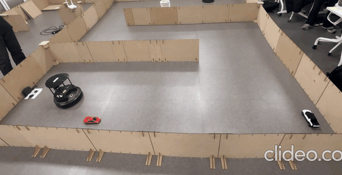
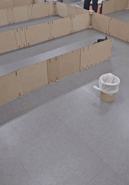
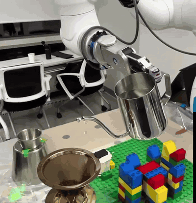
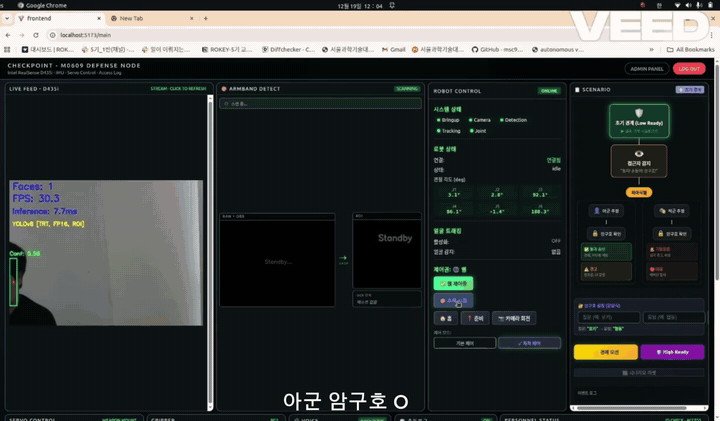
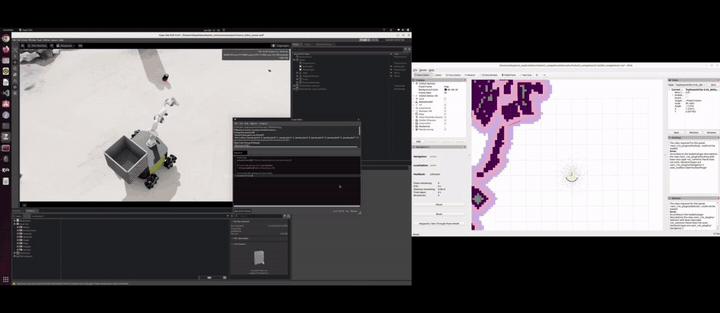

# ROKEY 부트캠프 팀 프로젝트 모음

두산로보틱스 ROKEY 부트캠프 5기(2025.07 – 2026.02)에서 C-1조로 참여한 팀 프로젝트 4개를 짧게 정리했습니다.
코드는 팀 저장소에 있고(커밋은 팀원 계정), 이 저장소에는 프로젝트별 목표 · 구성 · **제 담당** · 시연만 담았습니다.
담당 업무는 각 프로젝트 최종 발표자료의 역할표를 바탕으로, 제가 실제로 맡은 부분만 적었습니다.

| 기간 | 프로젝트 | 플랫폼 | 제 담당 | 코드 |
|---|---|---|---|---|
| 2025.11 (7일) | [Two Cops](#1-two-cops--협동-amr-도주-차량-추적차단) | TurtleBot4 × 2, ROS2 Humble, Nav2 | `nav_to_pose` 노드 | [팀 저장소](https://github.com/Rokey-C1/turtlebot4_ws) |
| 2025.11 – 12 | [BaRo Coffee](#2-baro-coffee--핸드드립-자동-추출-로봇) | 두산 M0609, ROS2, FastAPI, React | Arduino 로드셀 · Frontend | [팀 저장소](https://github.com/Rokey-C1/drip_coffee_maker) |
| 2025.12 | [BBangee](#3-bbangee--위병소-경계-자동화) | 두산 M0609, ESP32, YOLO | 권총 파지용 YOLO 분할 학습, 음성인식 | 공개 저장소 없음 |
| 2025.12 – 2026.01 | [Twinkle](#4-twinkle--디지털-트윈-자율-청소-로봇) | NVIDIA Isaac Sim, ROS2, Nav2 | 시뮬레이션 환경 구성, YOLO 탐지·분할 | 공개 저장소 없음 |

---

## 1. Two Cops — 협동 AMR 도주 차량 추적·차단

<table>
<tr>
<td width="75%" valign="top"> <b>① 추적</b>: 로봇이 빨간 RC카(도주 차량)를 향해 이동</td>
<td width="25%" valign="top"> <b>② 체포</b>: 두 대가 RC카 앞뒤를 막음</td>
</tr>
<tr><td colspan="2" align="center">2배속</td></tr>
</table>

- **목표**: AMR 두 대가 협력해 도주 차량(RC카)을 탐지 → 추적 → 양쪽에서 포위
- **구성**: YOLOv8n으로 차량 탐지 + OAK-D 깊이로 좌표 계산 → ROS2 DDS로 다른 로봇에 좌표 공유 → Nav2 `NavToPose`로 이동, Flask 모니터링
- **제 담당**: `nav_to_pose` 노드 개발 — TurtleBot4의 Nav2 NavToPose 예제를 이용해, 객체(도주 차량)를 인식할 때마다 그 좌표로 로봇이 이동하도록 설정
- 팀: C-1 · C-3조 합동 9명 · 코드: [Rokey-C1/turtlebot4_ws](https://github.com/Rokey-C1/turtlebot4_ws)

## 2. BaRo Coffee — 핸드드립 자동 추출 로봇

 
뜸 들이기(Blooming) 단계 — 로봇팔이 드립 포트로 물을 부음

- **목표**: 바리스타가 입력한 레시피(유속, 뜸 들이기, 1·2차 추출)대로 로봇팔이 드립 커피를 추출
- **구성**: 태블릿 웹 UI(React) → 백엔드(FastAPI + SQLite) → ROS2 레시피 매니저 → 두산 M0609 동작, 로드셀 무게로 붓는 양 확인(Arduino)
- **제 담당**: Arduino · Frontend
  - 로드셀 센서 하드웨어 구성과 Arduino 코드 작성
  - Arduino에서 받은 무게가 정해 둔 값 이상이면 다음 추출 단계로 넘어가는 로직 구현
  - go-home, 주전자 써클링(circling) 동작 구현에 참여
  - 프론트엔드(React · TypeScript)는 처음 쓰는 언어라 ChatGPT를 활용해 작성
- 팀: 5명 · 코드: [Rokey-C1/drip_coffee_maker](https://github.com/Rokey-C1/drip_coffee_maker)

## 3. BBangee — 위병소 경계 자동화

 
웹 대시보드 — 얼굴 추적 → 완장 인식 → 암구호 확인 → 로봇팔 동작 (얼굴은 이모지로 가림, 2배속)

- **목표**: 위병소에 접근하는 사람을 로봇이 식별하고, 암구호를 확인해 통과 · 경고로 대응
- **구성**: 카메라 영상에서 복장으로 아군/미상 1차 식별(YOLO) → 음성으로 암구호 확인(음성인식) → 결과에 따라 M0609 · ESP32(서보)가 동작, 웹 대시보드에 표시
- **제 담당**: 권총 파지용 객체 인식, 음성인식
  - 처음엔 SAM 3 모델을 가져와 쓰려 했으나 인식이 잘 안 되고 모델이 커서 포기
  - 비비탄 권총 손잡이에 빨간 점 표식을 붙이고 Roboflow에서 분할(segmentation) 라벨링 → YOLO 학습 → 로봇팔의 권총 파지 성공
- 팀: 4명 · 코드: 공개 저장소 없음

## 4. Twinkle — 디지털 트윈 자율 청소 로봇

 
왼쪽: Isaac Sim 속 청소 로봇 · 오른쪽: ROS2 지도 화면 (2배속)

- **목표**: 시뮬레이션(디지털 트윈)에서 검증한 청소 알고리즘을 실제 로봇으로 옮길 수 있게 개발
- **구성**: NVIDIA Isaac Sim 환경 + YOLO 분할로 쓰레기 인식 → ROS2 · Nav2로 이동 → 로봇팔로 집기
- **제 담당**: 시뮬레이션 환경 구성, YOLO 탐지 · 분할, 오브젝트 생성
- 팀: 4명 · 코드: 공개 저장소 없음

---

시연 GIF는 각 프로젝트 발표 영상에서 잘라 냈습니다.
